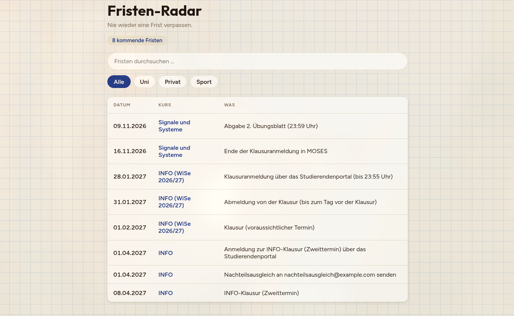
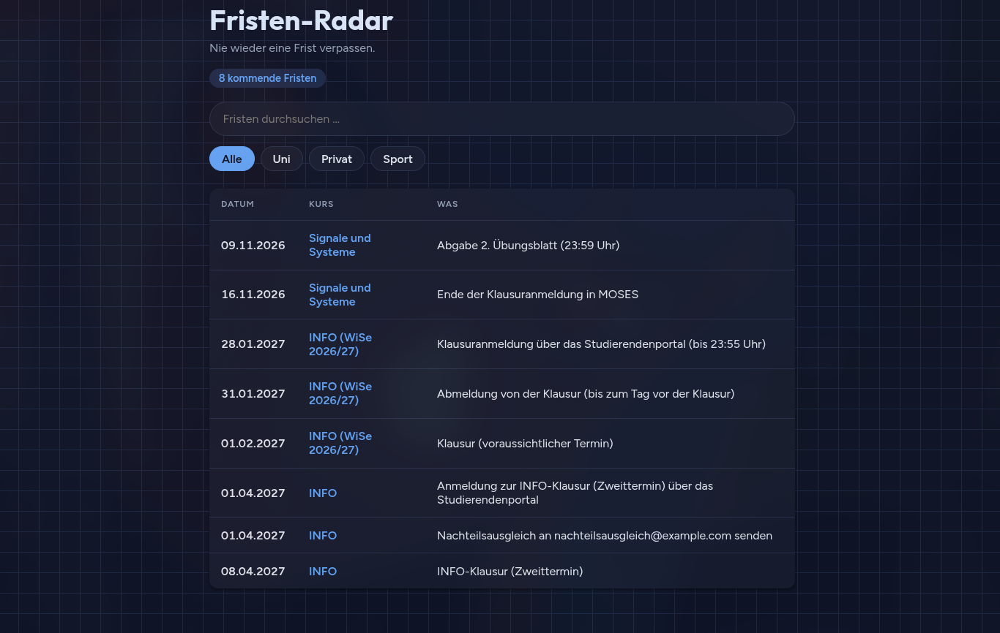

# Fristen-Radar

[Deutsche Fassung](README.de.md)

Finds deadlines in university emails with AI and shows them sorted on one page.
("Fristen" is German for deadlines. The interface is in German.)





## Why this project

In October 2026 I missed the sign-up for a tutorial at university.
You get a lot of different deadlines and emails from university and quickly lose track of them.
So I wanted a program that pulls the deadlines out of the emails and collects them in one place.

## How it works

1. Emails are stored as text files in a folder.
2. Every new email is sent to the Claude API. A Zod schema defines the form in which the deadlines come back.
3. The deadlines are saved in a SQLite database. `UNIQUE` prevents duplicates, and every email is processed only once.
4. A small web interface shows the upcoming deadlines sorted by date, in light or dark mode.

## Tech

- TypeScript on Node.js
- Claude API (`@anthropic-ai/sdk`) with structured output via Zod
- SQLite (`node:sqlite`) with prepared statements against SQL injection
- Web server with `node:http`, no framework
- 8 automated tests with `node:test` (the AI call is deliberately not tested, because its answers are not always the same)

## Getting started

You need Node.js 26 (tested with 26.4) and an API key from Anthropic.
Processing the emails costs a few cents.

```bash
git clone https://github.com/bennji030/fristen-radar.git
cd fristen-radar
npm install
echo "ANTHROPIC_API_KEY=your-key" > .env

# process the example emails
MAILS_ORDNER=beispiel-mails DB_DATEI=demo.db npm run dev

# start the page, then open http://localhost:3000
DB_DATEI=demo.db npm run server

# tests
npm test
```

## How I work with Claude Code

Claude Code accompanied the whole process, but I checked every line.
Some parts I typed myself, others Claude Code took over, for example creating the test database or setting up the web interface.

## Status and next steps

This is phase 1, a first working version.

The project runs locally. Emails are still placed in the folder by hand as text files.
The search bar and filters are already designed and will be connected together with the categories.

Next steps:
- categories such as exam, submission and sign-up, so that search and filters work
- more consistent answers from the AI
- Docker and a public demo
- automatic email fetching and reminders
