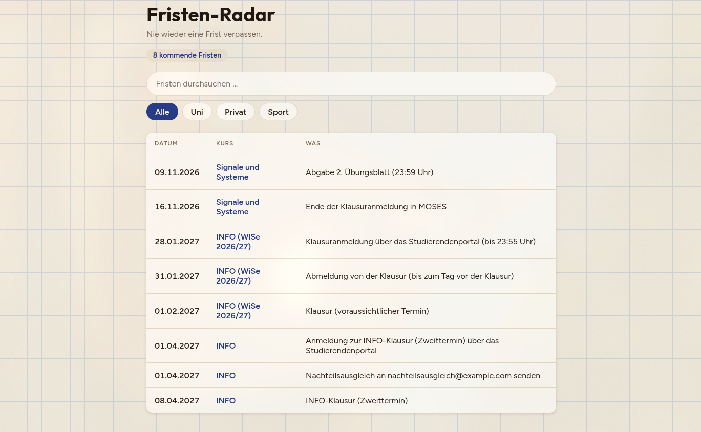
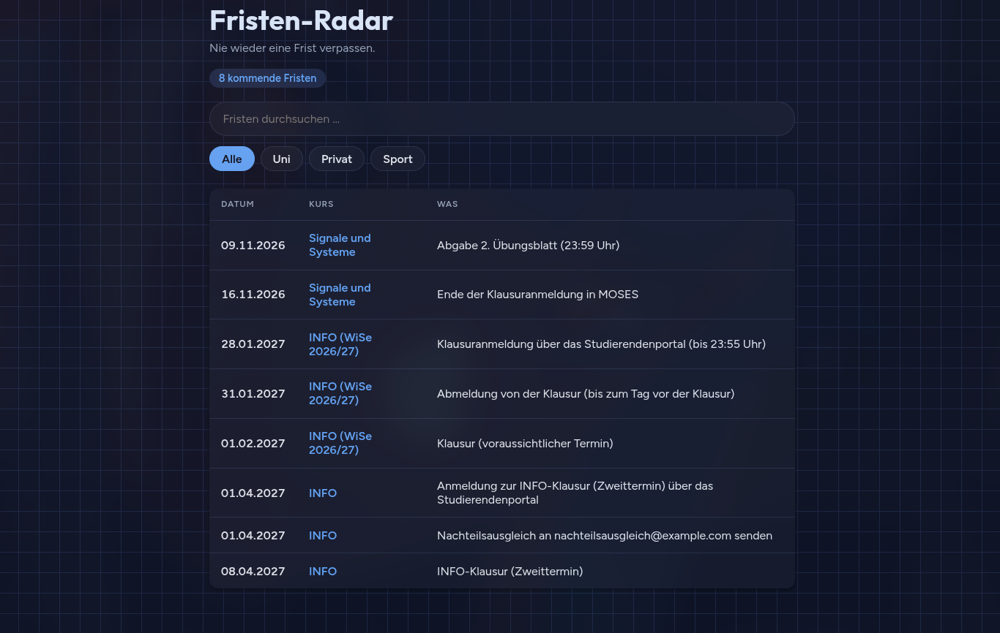

# Fristen-Radar

Findet Fristen in Uni-Mails mit KI und zeigt sie sortiert auf einer Seite.





## Warum dieses Projekt

Im Oktober 2026 habe ich die Tutoriumsanmeldung für ITPDG verpasst.
Von der Uni bekommt man viele verschiedene Fristen und Mails und verliert dabei schnell den Überblick.
Deshalb wollte ich ein Programm, das Fristen aus Mails herausholt und an einem Ort sammelt.

## Wie es funktioniert

1. Mails liegen als Textdateien in einem Ordner.
2. Jede neue Mail geht an die Claude-API. Ein Zod-Schema gibt vor, in welcher Form die Fristen zurückkommen.
3. Die Fristen landen in einer SQLite-Datenbank. Doppelte Fristen verhindert `UNIQUE`, und jede Mail wird nur einmal verarbeitet.
4. Eine kleine Weboberfläche zeigt die kommenden Fristen sortiert nach Datum, im hellen oder dunklen Modus.

## Technik

- TypeScript auf Node.js
- Claude-API (`@anthropic-ai/sdk`) mit strukturierter Antwort über Zod
- SQLite (`node:sqlite`) mit Prepared Statements gegen SQL-Injection
- Webserver mit `node:http`, ohne Framework
- 8 automatische Tests mit `node:test` (der KI-Aufruf ist bewusst nicht getestet, weil seine Antworten nicht immer gleich sind)

## Starten

Du brauchst Node.js 26 (getestet mit 26.4) und einen API-Schlüssel von Anthropic.
Das Auswerten der Mails kostet ein paar Cent.

```bash
git clone https://github.com/bennji030/fristen-radar.git
cd fristen-radar
npm install
echo "ANTHROPIC_API_KEY=dein-schluessel" > .env

# Beispiel-Mails auswerten
MAILS_ORDNER=beispiel-mails DB_DATEI=demo.db npm run dev

# Seite starten, danach http://localhost:3000 öffnen
DB_DATEI=demo.db npm run server

# Tests
npm test
```

## Wie ich mit Claude Code entwickle

Claude Code hat den Prozess dauerhaft begleitet, doch jede Zeile habe ich geprüft.
Teils habe ich selbst getippt, teils hat Claude Code Sachen übernommen, zum Beispiel das Erstellen der Testdatenbank oder das Aufsetzen der Weboberfläche.

## Stand und Ausblick

Das hier ist Phase 1, eine erste lauffähige Version.
Ich führe das Projekt weiter, wenn ich wieder Zeit habe.

Das Projekt läuft lokal. Mails müssen bisher von Hand als Textdateien abgelegt werden.
Suchleiste und Filter sind noch nicht funktionsfähig, sie sind bisher nur gestaltet.

Geplant für später:
- Kategorien wie Klausur, Abgabe und Anmeldung, damit Suche und Filter funktionieren
- einheitlichere Antworten der KI
- Docker und eine öffentliche Demo
- automatischer Mail-Abruf und Erinnerungen
